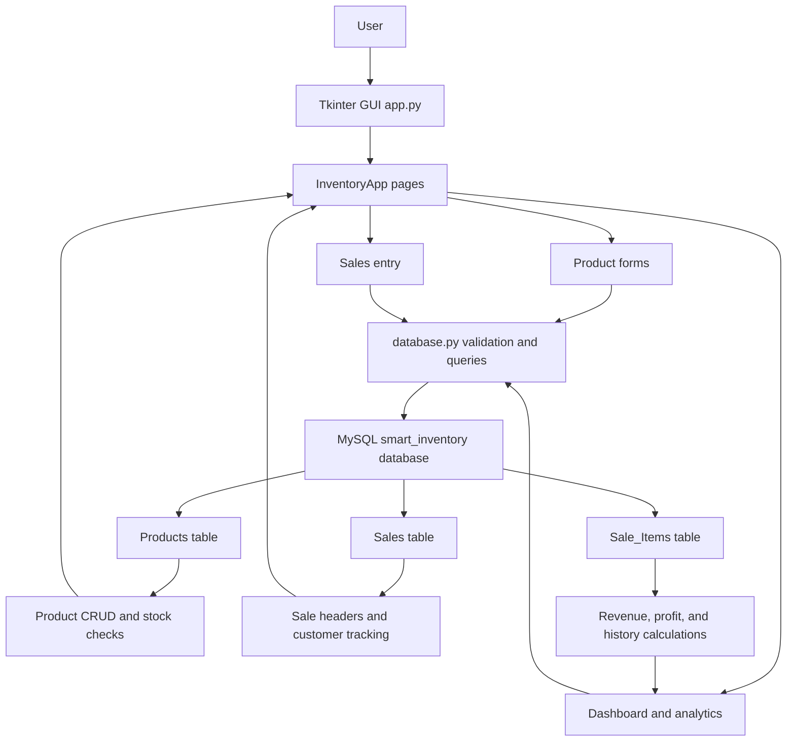

# Architecture Overview

## Layer responsibilities

### Presentation layer

- `app.py` contains the Tkinter UI, page layout, buttons, tables, and charts.
- It renders dashboard cards, product tables, sales history, and analytics visualizations.

### Data layer

- `database.py` centralizes database access.
- It validates user inputs, connects to MySQL, executes parameterized SQL, and handles transaction-safe stock updates.

### Persistence layer

- MySQL stores the actual inventory records.
- The schema is expected to include `Products`, `Sales`, and `Sale_Items`.

## Data flow

1. A user enters a product or sale action in the GUI.
2. `app.py` validates the input before calling a database helper.
3. `database.py` runs a MySQL query with parameters.
4. On sale, stock is checked and deducted within one transaction.
5. The result is returned to the interface and tables are refreshed.

## Deployment notes

This is a local desktop-system architecture. It is not designed as a web app or cloud service. The database connection depends on a local MySQL instance and the `SMART_INVENTORY_DB_PASSWORD` environment variable.
